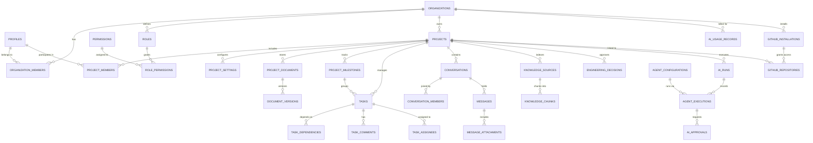

# Database Architecture & Schema Specification

**Project:** AI Engineering Workspace  
**Database Engine:** PostgreSQL 16+ (Supabase)  
**Extensions:** `uuid-ossp`, `pgcrypto`, `vector` (pgvector)  
**ORM:** Prisma ORM with versioned SQL migrations  

---

## 1. Architectural Strategy

The database is designed to support a multi-tenant, collaborative engineering platform with integrated vector-based project memory and AI agent telemetry.

### Core Design Rules
1. **Primary Keys:** Every table uses standard `UUIDv4` (`gen_random_uuid()`) for non-enumerable, globally unique entity identifiers.
2. **Tenant Scoping:** Every business entity belongs explicitly to an `organization_id`. Project-scoped entities additionally reference `project_id`.
3. **Auditing:** All transactional tables include `created_at` (timestamptz default now()), `updated_at` (timestamptz default now()), and user audit references (`created_by_id`, `updated_by_id`) where appropriate.
4. **Soft Deletes vs. Hard Deletes:**
   * Critical operational entities (organizations, projects, tasks, engineering decisions) support soft deletes (`deleted_at TIMESTAMP WITH TIME ZONE NULL`) to prevent accidental data destruction and maintain historical integrity.
   * Ephemeral records (tokens, temporary run logs, session cache) support cascading hard deletes.
5. **Referential Integrity:**
   * Organization cascade: Deleting an organization removes child assets or sets soft-delete triggers.
   * Project cascade: Tasks, documents, milestones, and project conversations are tied strictly to `project_id` with `ON DELETE CASCADE` (or guarded by soft delete flags).
   * User cascade: Deleting a user profile sets foreign keys in historical records to `NULL` (`ON DELETE SET NULL`) to retain project history, comments, and decision logs.

---

## 2. Entity-Relationship (ER) Overview

---

## 3. Detailed Table Specifications

### 3.1. Identity & Organization Domain

#### `profiles`
Maps directly 1:1 with `auth.users` of Supabase Auth.
* `id`: `UUID` (PK, references `auth.users.id` ON DELETE CASCADE)
* `email`: `VARCHAR(255)` (UNIQUE, NOT NULL)
* `full_name`: `VARCHAR(150)` (NOT NULL)
* `display_name`: `VARCHAR(100)`
* `avatar_url`: `TEXT`
* `status`: `VARCHAR(50)` (DEFAULT 'ACTIVE') — `ACTIVE`, `SUSPENDED`, `INACTIVE`
* `created_at`: `TIMESTAMPTZ` (DEFAULT NOW(), NOT NULL)
* `updated_at`: `TIMESTAMPTZ` (DEFAULT NOW(), NOT NULL)
* **Indexes:** `idx_profiles_email`, `idx_profiles_status`

#### `organizations`
Top-level tenant isolation container.
* `id`: `UUID` (PK, DEFAULT gen_random_uuid())
* `name`: `VARCHAR(150)` (NOT NULL)
* `slug`: `VARCHAR(100)` (UNIQUE, NOT NULL)
* `logo_url`: `TEXT`
* `billing_plan`: `VARCHAR(50)` (DEFAULT 'FREE')
* `created_by_id`: `UUID` (references `profiles.id` ON DELETE SET NULL)
* `created_at`: `TIMESTAMPTZ` (DEFAULT NOW(), NOT NULL)
* `updated_at`: `TIMESTAMPTZ` (DEFAULT NOW(), NOT NULL)
* `deleted_at`: `TIMESTAMPTZ` (NULL)
* **Indexes:** `idx_orgs_slug`, `idx_orgs_deleted_at`

#### `roles`
Role definitions per organization or global defaults.
* `id`: `UUID` (PK, DEFAULT gen_random_uuid())
* `organization_id`: `UUID` (NULL for system global roles, references `organizations.id` ON DELETE CASCADE)
* `name`: `VARCHAR(50)` (NOT NULL) — `OWNER`, `ADMIN`, `TEAM_LEAD`, `FRONTEND_DEV`, `BACKEND_DEV`, `QA_ENGINEER`, `AI_DEV`, `DEVOPS_DEV`
* `description`: `TEXT`
* `is_system_role`: `BOOLEAN` (DEFAULT FALSE)
* `created_at`: `TIMESTAMPTZ` (DEFAULT NOW(), NOT NULL)
* **Unique Constraints:** `(organization_id, name)`

#### `permissions`
Granular actions possible within the platform.
* `id`: `UUID` (PK, DEFAULT gen_random_uuid())
* `code`: `VARCHAR(100)` (UNIQUE, NOT NULL) — e.g., `projects:create`, `tasks:delete`, `ai:execute`, `knowledge:approve`
* `description`: `TEXT`
* `module`: `VARCHAR(50)` (NOT NULL)

#### `role_permissions`
Join table mapping roles to permissions.
* `role_id`: `UUID` (references `roles.id` ON DELETE CASCADE)
* `permission_id`: `UUID` (references `permissions.id` ON DELETE CASCADE)
* **Primary Key:** `(role_id, permission_id)`

#### `organization_members`
Association between a user and an organization.
* `id`: `UUID` (PK, DEFAULT gen_random_uuid())
* `organization_id`: `UUID` (references `organizations.id` ON DELETE CASCADE, NOT NULL)
* `user_id`: `UUID` (references `profiles.id` ON DELETE CASCADE, NOT NULL)
* `role_id`: `UUID` (references `roles.id` ON DELETE RESTRICT, NOT NULL)
* `status`: `VARCHAR(50)` (DEFAULT 'ACTIVE') — `INVITED`, `ACTIVE`, `SUSPENDED`
* `invited_by_id`: `UUID` (references `profiles.id` ON DELETE SET NULL)
* `joined_at`: `TIMESTAMPTZ`
* `created_at`: `TIMESTAMPTZ` (DEFAULT NOW(), NOT NULL)
* `updated_at`: `TIMESTAMPTZ` (DEFAULT NOW(), NOT NULL)
* **Unique Constraints:** `(organization_id, user_id)`
* **Indexes:** `idx_org_members_user`, `idx_org_members_org_status`

---

### 3.2. Projects Domain

#### `projects`
Core workspace container for software engineering projects.
* `id`: `UUID` (PK, DEFAULT gen_random_uuid())
* `organization_id`: `UUID` (references `organizations.id` ON DELETE CASCADE, NOT NULL)
* `name`: `VARCHAR(150)` (NOT NULL)
* `slug`: `VARCHAR(100)` (NOT NULL)
* `description`: `TEXT`
* `status`: `VARCHAR(50)` (DEFAULT 'PLANNING') — `PLANNING`, `ACTIVE`, `PAUSED`, `ARCHIVED`, `COMPLETED`
* `created_by_id`: `UUID` (references `profiles.id` ON DELETE SET NULL)
* `created_at`: `TIMESTAMPTZ` (DEFAULT NOW(), NOT NULL)
* `updated_at`: `TIMESTAMPTZ` (DEFAULT NOW(), NOT NULL)
* `deleted_at`: `TIMESTAMPTZ` (NULL)
* **Unique Constraints:** `(organization_id, slug)`
* **Indexes:** `idx_projects_org_slug`, `idx_projects_deleted`

#### `project_members`
Project-level access control list (ACL).
* `id`: `UUID` (PK, DEFAULT gen_random_uuid())
* `project_id`: `UUID` (references `projects.id` ON DELETE CASCADE, NOT NULL)
* `user_id`: `UUID` (references `profiles.id` ON DELETE CASCADE, NOT NULL)
* `project_role`: `VARCHAR(50)` (NOT NULL, DEFAULT 'CONTRIBUTOR') — `LEAD`, `CONTRIBUTOR`, `VIEWER`
* `created_at`: `TIMESTAMPTZ` (DEFAULT NOW(), NOT NULL)
* **Unique Constraints:** `(project_id, user_id)`

#### `project_settings`
Configurable parameters for AI execution, repo bindings, and notifications.
* `project_id`: `UUID` (PK, references `projects.id` ON DELETE CASCADE)
* `default_ai_provider`: `VARCHAR(50)` (DEFAULT 'openai')
* `default_ai_model`: `VARCHAR(100)` (DEFAULT 'gpt-4o')
* `require_agent_approval`: `BOOLEAN` (DEFAULT TRUE)
* `settings_json`: `JSONB` (DEFAULT '{}')
* `updated_at`: `TIMESTAMPTZ` (DEFAULT NOW(), NOT NULL)

#### `project_milestones`
Milestone tracking.
* `id`: `UUID` (PK, DEFAULT gen_random_uuid())
* `project_id`: `UUID` (references `projects.id` ON DELETE CASCADE, NOT NULL)
* `title`: `VARCHAR(200)` (NOT NULL)
* `description`: `TEXT`
* `target_date`: `DATE`
* `status`: `VARCHAR(50)` (DEFAULT 'OPEN') — `OPEN`, `IN_PROGRESS`, `ACHIEVED`, `CANCELLED`
* `created_at`: `TIMESTAMPTZ` (DEFAULT NOW(), NOT NULL)

#### `project_documents`
Project specifications, architectural guidelines, and design documents.
* `id`: `UUID` (PK, DEFAULT gen_random_uuid())
* `project_id`: `UUID` (references `projects.id` ON DELETE CASCADE, NOT NULL)
* `title`: `VARCHAR(255)` (NOT NULL)
* `slug`: `VARCHAR(150)` (NOT NULL)
* `content`: `TEXT` (NOT NULL)
* `doc_type`: `VARCHAR(50)` (DEFAULT 'SPECIFICATION') — `ARCHITECTURE`, `SPECIFICATION`, `API_CONTRACT`, `MEETING_NOTE`
* `status`: `VARCHAR(50)` (DEFAULT 'DRAFT') — `DRAFT`, `REVIEW`, `APPROVED`, `DEPRECATED`
* `current_version`: `INT` (DEFAULT 1, NOT NULL)
* `created_by_id`: `UUID` (references `profiles.id` ON DELETE SET NULL)
* `created_at`: `TIMESTAMPTZ` (DEFAULT NOW(), NOT NULL)
* `updated_at`: `TIMESTAMPTZ` (DEFAULT NOW(), NOT NULL)
* **Unique Constraints:** `(project_id, slug)`

#### `document_versions`
Audit log of document revisions for rollback and diffing.
* `id`: `UUID` (PK, DEFAULT gen_random_uuid())
* `document_id`: `UUID` (references `project_documents.id` ON DELETE CASCADE, NOT NULL)
* `version_number`: `INT` (NOT NULL)
* `content`: `TEXT` (NOT NULL)
* `change_summary`: `TEXT`
* `created_by_id`: `UUID` (references `profiles.id` ON DELETE SET NULL)
* `created_at`: `TIMESTAMPTZ` (DEFAULT NOW(), NOT NULL)
* **Unique Constraints:** `(document_id, version_number)`

---

### 3.3. Task Management Domain

#### `tasks`
* `id`: `UUID` (PK, DEFAULT gen_random_uuid())
* `project_id`: `UUID` (references `projects.id` ON DELETE CASCADE, NOT NULL)
* `milestone_id`: `UUID` (references `project_milestones.id` ON DELETE SET NULL)
* `parent_task_id`: `UUID` (references `tasks.id` ON DELETE CASCADE) — for sub-tasks
* `task_number`: `SERIAL` (Scoped per project or sequence)
* `title`: `VARCHAR(255)` (NOT NULL)
* `description`: `TEXT`
* `status`: `VARCHAR(50)` (DEFAULT 'TODO') — `TODO`, `IN_PROGRESS`, `IN_REVIEW`, `BLOCKED`, `DONE`, `CANCELLED`
* `priority`: `VARCHAR(50)` (DEFAULT 'MEDIUM') — `LOW`, `MEDIUM`, `HIGH`, `CRITICAL`
* `estimated_hours`: `NUMERIC(6, 2)`
* `due_date`: `DATE`
* `created_by_id`: `UUID` (references `profiles.id` ON DELETE SET NULL)
* `created_at`: `TIMESTAMPTZ` (DEFAULT NOW(), NOT NULL)
* `updated_at`: `TIMESTAMPTZ` (DEFAULT NOW(), NOT NULL)
* **Indexes:** `idx_tasks_project_status`, `idx_tasks_milestone`, `idx_tasks_parent`

#### `task_assignees`
Many-to-many relationship supporting multi-assignee task distribution.
* `task_id`: `UUID` (references `tasks.id` ON DELETE CASCADE)
* `user_id`: `UUID` (references `profiles.id` ON DELETE CASCADE)
* `assigned_at`: `TIMESTAMPTZ` (DEFAULT NOW())
* **Primary Key:** `(task_id, user_id)`

#### `task_dependencies`
Task DAG dependencies.
* `task_id`: `UUID` (references `tasks.id` ON DELETE CASCADE)
* `depends_on_task_id`: `UUID` (references `tasks.id` ON DELETE RESTRICT)
* `dependency_type`: `VARCHAR(50)` (DEFAULT 'BLOCKS') — `BLOCKS`, `RELATES_TO`
* **Primary Key:** `(task_id, depends_on_task_id)`

#### `task_comments`
* `id`: `UUID` (PK, DEFAULT gen_random_uuid())
* `task_id`: `UUID` (references `tasks.id` ON DELETE CASCADE, NOT NULL)
* `author_id`: `UUID` (references `profiles.id` ON DELETE SET NULL)
* `content`: `TEXT` (NOT NULL)
* `is_ai_generated`: `BOOLEAN` (DEFAULT FALSE)
* `created_at`: `TIMESTAMPTZ` (DEFAULT NOW(), NOT NULL)
* `updated_at`: `TIMESTAMPTZ` (DEFAULT NOW(), NOT NULL)

---

### 3.4. Communication Domain

#### `conversations`
Threaded discussion rooms for projects, direct developer messaging, and AI interactions.
* `id`: `UUID` (PK, DEFAULT gen_random_uuid())
* `project_id`: `UUID` (references `projects.id` ON DELETE CASCADE, NOT NULL)
* `title`: `VARCHAR(200)`
* `type`: `VARCHAR(50)` (NOT NULL) — `CHANNEL`, `DIRECT_MESSAGE`, `AI_THREAD`, `TASK_THREAD`
* `associated_task_id`: `UUID` (references `tasks.id` ON DELETE SET NULL)
* `created_by_id`: `UUID` (references `profiles.id` ON DELETE SET NULL)
* `created_at`: `TIMESTAMPTZ` (DEFAULT NOW(), NOT NULL)
* `updated_at`: `TIMESTAMPTZ` (DEFAULT NOW(), NOT NULL)

#### `conversation_members`
* `conversation_id`: `UUID` (references `conversations.id` ON DELETE CASCADE)
* `user_id`: `UUID` (references `profiles.id` ON DELETE CASCADE)
* `joined_at`: `TIMESTAMPTZ` (DEFAULT NOW())
* `last_read_message_id`: `UUID`
* **Primary Key:** `(conversation_id, user_id)`

#### `messages`
* `id`: `UUID` (PK, DEFAULT gen_random_uuid())
* `conversation_id`: `UUID` (references `conversations.id` ON DELETE CASCADE, NOT NULL)
* `sender_id`: `UUID` (references `profiles.id` ON DELETE SET NULL) — NULL when authored by an AI Agent
* `sender_type`: `VARCHAR(50)` (DEFAULT 'USER') — `USER`, `AI_AGENT`, `SYSTEM`
* `agent_name`: `VARCHAR(100)` (NULL if sender is user)
* `content`: `TEXT` (NOT NULL)
* `metadata`: `JSONB` (DEFAULT '{}') — stores citations, token counts, or command cards
* `created_at`: `TIMESTAMPTZ` (DEFAULT NOW(), NOT NULL)
* `updated_at`: `TIMESTAMPTZ` (DEFAULT NOW(), NOT NULL)
* **Indexes:** `idx_messages_conversation_created`

#### `message_attachments`
* `id`: `UUID` (PK, DEFAULT gen_random_uuid())
* `message_id`: `UUID` (references `messages.id` ON DELETE CASCADE, NOT NULL)
* `file_name`: `VARCHAR(255)` (NOT NULL)
* `file_size`: `INT` (NOT NULL)
* `mime_type`: `VARCHAR(100)` (NOT NULL)
* `storage_path`: `TEXT` (NOT NULL)
* `created_at`: `TIMESTAMPTZ` (DEFAULT NOW(), NOT NULL)

---

### 3.5. Project Knowledge & Memory Domain (RAG & Vectors)

#### `knowledge_sources`
Ingested artifacts (files, PRs, technical specs, external docs).
* `id`: `UUID` (PK, DEFAULT gen_random_uuid())
* `project_id`: `UUID` (references `projects.id` ON DELETE CASCADE, NOT NULL)
* `source_type`: `VARCHAR(50)` (NOT NULL) — `DOCUMENT`, `GITHUB_REPO`, `DECISION_RECORD`, `CONVERSATION`
* `title`: `VARCHAR(255)` (NOT NULL)
* `source_uri`: `TEXT`
* `checksum`: `VARCHAR(64)` (SHA-256 for change detection)
* `status`: `VARCHAR(50)` (DEFAULT 'SYNCED') — `PENDING`, `INDEXING`, `SYNCED`, `ERROR`
* `error_message`: `TEXT`
* `created_at`: `TIMESTAMPTZ` (DEFAULT NOW(), NOT NULL)
* `updated_at`: `TIMESTAMPTZ` (DEFAULT NOW(), NOT NULL)
* **Indexes:** `idx_knowledge_sources_project`

#### `knowledge_chunks`
Vector-backed embeddings for contextual retrieval.
* `id`: `UUID` (PK, DEFAULT gen_random_uuid())
* `knowledge_source_id`: `UUID` (references `knowledge_sources.id` ON DELETE CASCADE, NOT NULL)
* `project_id`: `UUID` (references `projects.id` ON DELETE CASCADE, NOT NULL)
* `organization_id`: `UUID` (references `organizations.id` ON DELETE CASCADE, NOT NULL)
* `chunk_index`: `INT` (NOT NULL)
* `content`: `TEXT` (NOT NULL)
* `token_count`: `INT` (NOT NULL)
* `embedding`: `vector(1536)` (OpenAI text-embedding-3-small or compatible dimensions)
* `metadata`: `JSONB` (NOT NULL DEFAULT '{}') — includes tags, approved status, source titles, file paths
* `created_at`: `TIMESTAMPTZ` (DEFAULT NOW(), NOT NULL)
* **Indexes:**
  * `idx_knowledge_chunks_project_org`: B-Tree on `(organization_id, project_id)`
  * `idx_knowledge_chunks_embedding`: HNSW index on `embedding vector_cosine_ops`

#### `engineering_decisions`
Architectural Decision Records (ADR).
* `id`: `UUID` (PK, DEFAULT gen_random_uuid())
* `project_id`: `UUID` (references `projects.id` ON DELETE CASCADE, NOT NULL)
* `title`: `VARCHAR(255)` (NOT NULL)
* `status`: `VARCHAR(50)` (DEFAULT 'PROPOSED') — `PROPOSED`, `ACCEPTED`, `SUPERSEDED`, `REJECTED`
* `context`: `TEXT` (NOT NULL)
* `decision`: `TEXT` (NOT NULL)
* `consequences`: `TEXT` (NOT NULL)
* `superseded_by_id`: `UUID` (references `engineering_decisions.id` ON DELETE SET NULL)
* `approved_by_id`: `UUID` (references `profiles.id` ON DELETE SET NULL)
* `created_at`: `TIMESTAMPTZ` (DEFAULT NOW(), NOT NULL)
* `updated_at`: `TIMESTAMPTZ` (DEFAULT NOW(), NOT NULL)

---

### 3.6. AI & Agent Orchestration Domain

#### `ai_providers`
Configured providers across system and organizations.
* `id`: `UUID` (PK, DEFAULT gen_random_uuid())
* `name`: `VARCHAR(50)` (NOT NULL) — `openai`, `anthropic`, `ollama`
* `is_active`: `BOOLEAN` (DEFAULT TRUE)
* `base_url`: `TEXT` (NULL for official cloud endpoints; configured for local Ollama)
* `created_at`: `TIMESTAMPTZ` (DEFAULT NOW(), NOT NULL)

#### `ai_models`
Catalog of supported models and cost tracking.
* `id`: `UUID` (PK, DEFAULT gen_random_uuid())
* `provider_id`: `UUID` (references `ai_providers.id` ON DELETE CASCADE, NOT NULL)
* `model_identifier`: `VARCHAR(100)` (NOT NULL) — e.g. `gpt-4o`, `claude-3-5-sonnet-20241022`, `llama3.2:latest`
* `context_window`: `INT` (NOT NULL)
* `input_cost_per_million`: `NUMERIC(10, 4)` (DEFAULT 0)
* `output_cost_per_million`: `NUMERIC(10, 4)` (DEFAULT 0)
* `is_embedding_model`: `BOOLEAN` (DEFAULT FALSE)

#### `agent_configurations`
System-defined and customized personas.
* `id`: `UUID` (PK, DEFAULT gen_random_uuid())
* `project_id`: `UUID` (references `projects.id` ON DELETE CASCADE) — NULL for global standard agents
* `name`: `VARCHAR(100)` (NOT NULL) — e.g. `Frontend Agent`, `Backend Agent`, `QA Agent`, `Architecture Agent`
* `role_type`: `VARCHAR(50)` (NOT NULL)
* `system_prompt`: `TEXT` (NOT NULL)
* `allowed_tools`: `JSONB` (NOT NULL DEFAULT '[]') — array of tool names
* `is_active`: `BOOLEAN` (DEFAULT TRUE)
* `created_at`: `TIMESTAMPTZ` (DEFAULT NOW(), NOT NULL)

#### `ai_runs`
Top-level execution record for any AI request.
* `id`: `UUID` (PK, DEFAULT gen_random_uuid())
* `organization_id`: `UUID` (references `organizations.id` ON DELETE CASCADE, NOT NULL)
* `project_id`: `UUID` (references `projects.id` ON DELETE CASCADE, NOT NULL)
* `user_id`: `UUID` (references `profiles.id` ON DELETE SET NULL)
* `run_type`: `VARCHAR(50)` (NOT NULL) — `CHAT`, `RAG_QUERY`, `TASK_GENERATION`, `AGENT_PLAN`
* `status`: `VARCHAR(50)` (DEFAULT 'PENDING') — `PENDING`, `RUNNING`, `COMPLETED`, `FAILED`, `AWAITING_APPROVAL`
* `prompt_tokens`: `INT` (DEFAULT 0)
* `completion_tokens`: `INT` (DEFAULT 0)
* `total_tokens`: `INT` (DEFAULT 0)
* `cost_estimated`: `NUMERIC(10, 6)` (DEFAULT 0)
* `execution_time_ms`: `INT`
* `error_message`: `TEXT`
* `created_at`: `TIMESTAMPTZ` (DEFAULT NOW(), NOT NULL)

#### `agent_executions`
Granular step-by-step trace of agent operations.
* `id`: `UUID` (PK, DEFAULT gen_random_uuid())
* `ai_run_id`: `UUID` (references `ai_runs.id` ON DELETE CASCADE, NOT NULL)
* `agent_config_id`: `UUID` (references `agent_configurations.id` ON DELETE RESTRICT, NOT NULL)
* `step_number`: `INT` (NOT NULL)
* `action_type`: `VARCHAR(50)` (NOT NULL) — `THINKING`, `TOOL_INVOCATION`, `RESPONSE`
* `tool_name`: `VARCHAR(100)`
* `tool_input`: `JSONB`
* `tool_output`: `JSONB`
* `status`: `VARCHAR(50)` (DEFAULT 'EXECUTING')
* `created_at`: `TIMESTAMPTZ` (DEFAULT NOW(), NOT NULL)

#### `ai_approvals`
Human-in-the-loop authorization gate for sensitive actions.
* `id`: `UUID` (PK, DEFAULT gen_random_uuid())
* `ai_run_id`: `UUID` (references `ai_runs.id` ON DELETE CASCADE, NOT NULL)
* `agent_execution_id`: `UUID` (references `agent_executions.id` ON DELETE CASCADE, NOT NULL)
* `action_description`: `TEXT` (NOT NULL)
* `proposed_payload`: `JSONB` (NOT NULL)
* `status`: `VARCHAR(50)` (DEFAULT 'PENDING') — `PENDING`, `APPROVED`, `REJECTED`
* `decided_by_id`: `UUID` (references `profiles.id` ON DELETE SET NULL)
* `rejection_reason`: `TEXT`
* `decided_at`: `TIMESTAMPTZ`
* `created_at`: `TIMESTAMPTZ` (DEFAULT NOW(), NOT NULL)

#### `ai_usage_records`
Aggregate billing and consumption log.
* `id`: `UUID` (PK, DEFAULT gen_random_uuid())
* `organization_id`: `UUID` (references `organizations.id` ON DELETE CASCADE, NOT NULL)
* `model_identifier`: `VARCHAR(100)` (NOT NULL)
* `tokens_input`: `BIGINT` (DEFAULT 0)
* `tokens_output`: `BIGINT` (DEFAULT 0)
* `total_cost`: `NUMERIC(12, 6)` (DEFAULT 0)
* `billing_period`: `VARCHAR(7)` (NOT NULL) — Format: `YYYY-MM`
* `created_at`: `TIMESTAMPTZ` (DEFAULT NOW(), NOT NULL)
* **Unique Constraints:** `(organization_id, model_identifier, billing_period)`

---

### 3.7. Integrations & Operations Domain

#### `integrations`
Active integration connections per project or organization.
* `id`: `UUID` (PK, DEFAULT gen_random_uuid())
* `organization_id`: `UUID` (references `organizations.id` ON DELETE CASCADE, NOT NULL)
* `provider`: `VARCHAR(50)` (NOT NULL) — `GITHUB`, `SLACK`, `DISCORD`
* `config_json`: `JSONB` (NOT NULL DEFAULT '{}')
* `is_active`: `BOOLEAN` (DEFAULT TRUE)
* `created_at`: `TIMESTAMPTZ` (DEFAULT NOW(), NOT NULL)

#### `github_installations`
* `id`: `UUID` (PK, DEFAULT gen_random_uuid())
* `organization_id`: `UUID` (references `organizations.id` ON DELETE CASCADE, NOT NULL)
* `installation_id`: `BIGINT` (UNIQUE, NOT NULL)
* `account_login`: `VARCHAR(150)` (NOT NULL)
* `account_type`: `VARCHAR(50)` (NOT NULL)
* `created_at`: `TIMESTAMPTZ` (DEFAULT NOW(), NOT NULL)

#### `github_repositories`
* `id`: `UUID` (PK, DEFAULT gen_random_uuid())
* `project_id`: `UUID` (references `projects.id` ON DELETE CASCADE, NOT NULL)
* `installation_id`: `UUID` (references `github_installations.id` ON DELETE CASCADE, NOT NULL)
* `repo_id`: `BIGINT` (NOT NULL)
* `full_name`: `VARCHAR(255)` (NOT NULL) — e.g. `org/repo-name`
* `default_branch`: `VARCHAR(100)` (DEFAULT 'main')
* `created_at`: `TIMESTAMPTZ` (DEFAULT NOW(), NOT NULL)
* **Unique Constraints:** `(project_id, repo_id)`

#### `github_webhook_events`
Audit log and idempotency register for GitHub incoming events.
* `id`: `UUID` (PK, DEFAULT gen_random_uuid())
* `delivery_id`: `VARCHAR(100)` (UNIQUE, NOT NULL) — GitHub `X-GitHub-Delivery`
* `event_type`: `VARCHAR(100)` (NOT NULL) — `push`, `pull_request`, etc.
* `payload`: `JSONB` (NOT NULL)
* `status`: `VARCHAR(50)` (DEFAULT 'PENDING') — `PENDING`, `PROCESSED`, `IGNORED`, `FAILED`
* `error_message`: `TEXT`
* `created_at`: `TIMESTAMPTZ` (DEFAULT NOW(), NOT NULL)

#### `notifications`
User alert inbox.
* `id`: `UUID` (PK, DEFAULT gen_random_uuid())
* `user_id`: `UUID` (references `profiles.id` ON DELETE CASCADE, NOT NULL)
* `organization_id`: `UUID` (references `organizations.id` ON DELETE CASCADE, NOT NULL)
* `title`: `VARCHAR(255)` (NOT NULL)
* `body`: `TEXT` (NOT NULL)
* `type`: `VARCHAR(50)` (NOT NULL) — `TASK_ASSIGNED`, `APPROVAL_REQUIRED`, `MENTION`, `SYSTEM`
* `link_url`: `TEXT`
* `is_read`: `BOOLEAN` (DEFAULT FALSE)
* `created_at`: `TIMESTAMPTZ` (DEFAULT NOW(), NOT NULL)
* **Indexes:** `idx_notifications_user_read`

#### `audit_logs`
Immutable compliance and security record.
* `id`: `UUID` (PK, DEFAULT gen_random_uuid())
* `organization_id`: `UUID` (references `organizations.id` ON DELETE CASCADE, NOT NULL)
* `actor_id`: `UUID` (references `profiles.id` ON DELETE SET NULL)
* `action`: `VARCHAR(100)` (NOT NULL) — e.g. `USER_INVITED`, `ROLE_UPDATED`, `PROJECT_DELETED`, `SECRET_ACCESSED`
* `entity_type`: `VARCHAR(100)` (NOT NULL)
* `entity_id`: `UUID` (NOT NULL)
* `details`: `JSONB` (NOT NULL DEFAULT '{}')
* `ip_address`: `VARCHAR(45)`
* `user_agent`: `TEXT`
* `created_at`: `TIMESTAMPTZ` (DEFAULT NOW(), NOT NULL)
* **Indexes:** `idx_audit_org_created`, `idx_audit_actor`

